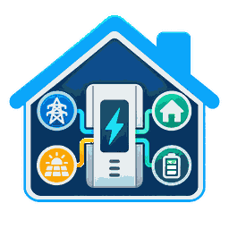

# ⚡ EcoFlow Smart Home Panel v1



**Bring your first-generation EcoFlow Smart Home Panel into Home Assistant.** Monitor grid power, backup batteries, circuit status and detailed device diagnostics — with native entities and Home Assistant history.


[](LICENSE)

> [!IMPORTANT]
> **Early preview (v0.1.2) · Read-only.** Supports the **original Smart Home Panel (v1)**, not SHP2 or newer models. This version **cannot switch circuits, charge batteries or change device settings**. Test it before using it in your main Home Assistant installation.

## ✨ Features

- ⚡ **Live monitoring** — grid availability, backup battery level, circuit power-source status and energy readings.
- 📊 **Detailed diagnostics** — discover individual values exposed by EcoFlow's Quota API, including per-circuit and per-battery data.
- 🏷️ **Understandable entities** — English/German names, descriptions and original quota paths.
- 🕘 **Selective history** — Home Assistant Recorder stores enabled entities; most advanced diagnostics start disabled to save space.
- ☁️ **Cloud connection** — authenticated EcoFlow API polling, configurable update interval and error handling.

## 📦 Installation

**Requirements:** Home Assistant **2026.10+**, an **EcoFlow Smart Home Panel v1**, and EcoFlow Developer **Access Key**, **Secret Key** and panel **serial number**.

### Option A: HACS (recommended)

This integration is available as a **custom HACS repository**. It is **not yet listed in the default HACS catalog**.

1. Open **HACS** in Home Assistant.
2. Open the **⋮ menu → Custom repositories**.
3. Add `https://github.com/nickwinger/ecoflow_smart_home_panel_v1` and select **Integration**.
4. Find **EcoFlow Smart Home Panel v1** in HACS and select **Download**.
5. **Restart Home Assistant**, then follow [Configuration](#-configuration).

[HACS help: Custom repositories](https://www.hacs.dev/docs/faq/custom_repositories/)

### Option B: Manual installation

1. Download this repository as a ZIP file.
2. Copy the directory `custom_components/ecoflow_smart_home_panel_v1` to `<config>/custom_components/` in Home Assistant.
3. **Restart Home Assistant** and follow [Configuration](#-configuration).

Your resulting path should be:

```text
<config>/custom_components/ecoflow_smart_home_panel_v1/manifest.json
```

## 🔑 Configuration

1. Go to **Settings → Devices & services → Add integration**.
2. Search for **EcoFlow Smart Home Panel v1**.
3. Enter your **Access Key**, **Secret Key** and **panel serial number**.
4. Select the correct API region (**EU** or **Global**) and confirm you have an **SHP v1**.

That's it! Your panel and available entities will appear under **Devices & services**. You can adjust polling in the integration **Options** (default: **5 seconds**, configurable from **5–900 seconds**). Entries without a saved interval adopt this default after restart; explicitly saved custom intervals are preserved.

> The integration uses the EcoFlow Developer API over the internet; it does not connect directly to the panel on your local network.

## 📈 Entities & history

| Example | What it tells you |
| --- | --- |
| Grid availability | Whether utility grid power is available |
| Backup battery level | Backup system charge percentage (when valid) |
| Circuit 1–10 power source | Grid, battery or off/unknown |
| Grid voltage & frequency | Reported nominal grid settings |
| Daily grid/backup energy | Raw daily readings (not yet Energy Dashboard totals) |
| Advanced diagnostics | Additional available quota fields, disabled by default |

**Want more data?** Open the panel's **Entities** list, show disabled entities and enable only the diagnostics you need. The complete list depends on your device's responses.

- **Enabled entities:** normal Home Assistant history, subject to your Recorder settings.
- **Disabled entities:** no new recorded history.
- **Long-term statistics:** only for measurements with verified types, units and state classes. Not every numeric quota field qualifies.

For full field descriptions and technical details, see the [entity catalog](docs/ENTITY_CATALOG.md).

## 🛠️ Troubleshooting

| Problem | Try this |
| --- | --- |
| Integration not found | Restart Home Assistant and refresh your browser after installation |
| Setup fails | Verify the keys, serial number and EU/Global region; retry if EcoFlow returns an incomplete response |
| A value is unavailable or unknown | The API may have omitted it or returned an unrecognized code; the integration deliberately avoids guessing |
| Too many entities | Most raw diagnostic entities are disabled by default; enable only what you need |

[Report an issue](https://github.com/nickwinger/ecoflow_smart_home_panel_v1/issues)

## 💻 Development

Develop and test against a **separate, disposable Home Assistant instance** — never your production configuration.

- [Local VS Code / WSL Dev Container guide](docs/LOCAL_LIVE_TEST.md)
- [Developer scripts and complete HA DEV reinstall](scripts.md)
- [Technical architecture](docs/ARCHITECTURE.md)
- [Migration from existing helper scripts](docs/MIGRATION.md)
- [API references and data provenance](docs/REFERENCE_SOURCES.md)

## 📄 License & disclaimer

Licensed under [MIT](LICENSE). Unofficial community project — **not affiliated with or endorsed by EcoFlow or Home Assistant**. EcoFlow and Smart Home Panel are trademarks of their respective owners.
